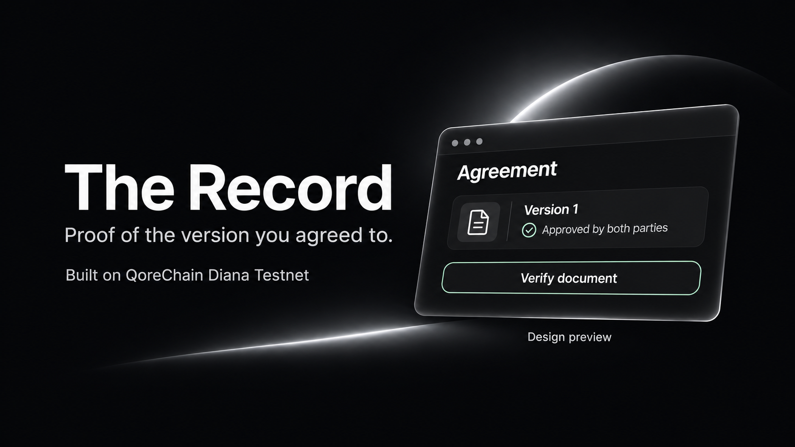
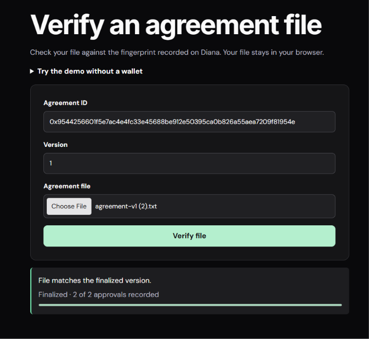
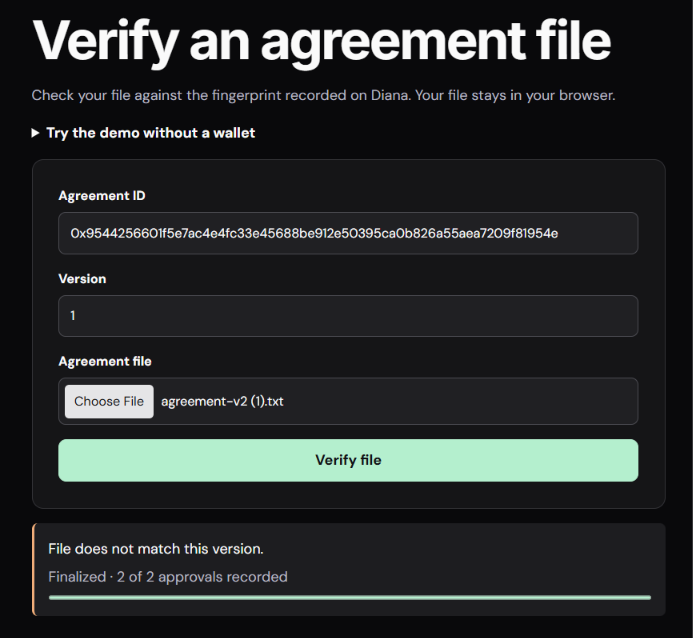

  
  
  
  

**The Record lets two parties review a document, approve its exact version on QoreChain Diana Testnet, and verify a copy later.** Document bytes stay off-chain; private drafts are a separate service-storage feature.

**[Live app](https://the-record-diana-verifier.flutteringpeach8.chatgpt.site/) · [Watch demo on YouTube](https://youtu.be/Q-D4JEWY2oo) · [Try the demo](https://the-record-diana-verifier.flutteringpeach8.chatgpt.site/?id=0x9544256601f5e7ac4e4fc33e45688be912e50395ca0b826a55aea7209f81954e&version=1#verify-title) · [Walkthrough](https://the-record-diana-verifier.flutteringpeach8.chatgpt.site/walkthrough) · [Evidence index](https://github.com/0xaje/TheRecord/blob/main/docs/CURRENT_STATUS.md)**

Current source: **[main](https://github.com/0xaje/TheRecord/tree/main)**. The verified working history was merged through [PR #1](https://github.com/0xaje/TheRecord/pull/1). Latest local regression: **89 checks passed, 20 November 2026**. See [current status and open gates](https://github.com/0xaje/TheRecord/blob/main/docs/CURRENT_STATUS.md).

[Problem](#the-problem) · [Working proof](#working-proof) · [QoreChain integration](#built-on-qorechain) · [Architecture](#architecture) · [Run locally](#run-locally) · [Limits](#security-and-limits)

## Watch the demo

[**Watch The Record on YouTube**](https://youtu.be/Q-D4JEWY2oo)

The video explains the problem and demonstrates drafts, saved revisions, original/changed file verification and agreement history. It uses a new demonstration draft and previously recorded Diana Testnet approvals. Both distinct signer wallets in those tests were operated by the creator; this is not an independent two-person signing session.

Prefer to explore directly? [Try it yourself](https://the-record-diana-verifier.flutteringpeach8.chatgpt.site/?id=0x9544256601f5e7ac4e4fc33e45688be912e50395ca0b826a55aea7209f81954e&version=1#verify-title).

## Try it without a wallet

1. Open **Try the demo**, then use **Demo — watch or test**.
2. Download the original, choose that file and select **Verify file** with **version 1**.
3. Expect **File matches the finalized version** and **2 of 2 approvals**.
4. Choose the changed copy while keeping **version 1**. Expect **File does not match this version**.

This hashes the actual selected file locally and reads Diana. Failed lookups show an error rather than a recorded success. File checking needs no wallet, payment or document upload. Creating records and approving them require funded, eligible Diana accounts.

## The problem

A document says **Friday**. A later copy says **Monday**. Which exact file did both people approve?

Shared files, chat acknowledgements and revisions can leave people reconstructing the terms later. The Record links an exact file fingerprint to two designated signing accounts, a version and inspectable approval history.

Our [research review](https://github.com/0xaje/TheRecord/blob/main/docs/research/WHY_THE_RECORD.md) includes primary sources from the UK and Canada, freelancer-payment reporting in the US, and Nigerian contracting-record context. It distinguishes documented facts from our interpretation, compares existing signing tools, and records what is unvalidated. These examples explain the need for clearer records; they do not prove this app would prevent those disputes or establish customer demand.

## How it works

~~~mermaid
flowchart TD
  A["Draft and review the terms"] --> B["Record the agreed file fingerprint"]
  B --> C["Both designated accounts approve this version"]
  C --> D["Diana finalizes the version"]
  D --> E["Check a copy locally against the record"]
  D --> F["Propose an amendment"]
  F --> G["Fresh approvals for the new version"]
  F --> H["V2: withdraw a pending amendment"]
  H --> I["Re-propose with a new version number"]
  I --> G
~~~

Saved draft revisions are private workspace history. Diana agreement versions are public records created separately. In the withdrawal-enabled contract, withdrawing a pending amendment preserves its history; its approvals do not transfer to a correction. Earlier finalized versions remain verifiable.

## Working proof

| Demonstrated result | Inspect the evidence |
| --- | --- |
| Two distinct signer approvals and finalized original | [Diana evidence](https://github.com/0xaje/TheRecord/blob/main/docs/diana-evidence.md) |
| Original matches; changed copy fails | [Captured original](https://github.com/0xaje/TheRecord/blob/main/docs/evidence/demo-original-match.png), [changed copy](https://github.com/0xaje/TheRecord/blob/main/docs/evidence/demo-changed-mismatch.png), [latest browser/phone checks](https://github.com/0xaje/TheRecord/blob/main/docs/audit/2026-11-19/verifier-errors/REVIEW.md) |
| V1 finalized, V2 withdrawn, V3 freshly approved | [Lifecycle and receipts](https://github.com/0xaje/TheRecord/blob/main/docs/withdrawal/LIVE_ACCEPTANCE.md), [V3 finalization receipt](https://dashboard.qorechain.io/explorer/tx/0xab11d9e3409fd974af93039a7d30abee1f409027c183cdbb1e61ad8c32086960) |
| Restricted EVM window admits permitted contract and refuses outside recipient | [V2 scope proof and limits](https://github.com/0xaje/TheRecord/blob/main/docs/withdrawal/SCOPED_WINDOW_LIVE.md) |
| Deployed V2 runtime matches its source-bound artifact | [Deployment verification](https://github.com/0xaje/TheRecord/blob/main/docs/withdrawal/deployment-verified.json) |
| Saved revisions, Trash/deletion, limits, recovery and human-check acceptance | [Engineering evidence index](https://github.com/0xaje/TheRecord/blob/main/docs/CURRENT_STATUS.md#engineering-checkpoints) |

<table>
  <tr>
    <td> Captured original-file match</td>
    <td> Captured changed-copy rejection</td>
  </tr>
</table>

The owner operated both distinct wallets. **Independent two-person full-workflow testing remains pending.** Mobile screenshots were unavailable in QoreX, so phone results are identified as owner reports. Automated failure fixtures, real receipts and browser observations are labelled separately.

## Built on QoreChain

| Component | Actual role |
| --- | --- |
| **QoreChain Diana Testnet** | Records fingerprints, designated accounts, versions, approvals and finalization. EVM chain ID **9800**. |
| **QoreX** | Connects the user's account and requests the agreement-approval signature inside the wallet. |
| **ML-DSA-87 / pqcVerify** | Contract checks approval bound to chain, contract, agreement, version, fingerprint and signer. Registered-key and proof-of-possession checks precede approval. |
| **QoreChain SDK / scoped EVM window** | Disposable-account SDK test proves target admission and outside-target refusal on Diana. The website's advanced window page is inspect/check-only. |
| **QoreChain Explorer** | Public receipt inspection. |
| **QCAIA auditor** | Source-matched generated reports and a finding-response ledger; formal finding closure/event acceptance remain open. |

An ordinary EVM transaction signature, its PQ-authorized access window, and the agreement's PQ approval verification are distinct layers. A window alone does not prove agreement approval.

## Architecture

~~~mermaid
flowchart LR
  subgraph Device["User device"]
    F["Selected file"] --> H["Local SHA-256 comparison"]
    W["QoreX wallet"]
  end
  subgraph Service["Private draft service"]
    API["Worker API"] --> DB["D1 drafts and revisions"]
  end
  D["Diana agreement contract"]
  H -->|"Read recorded fingerprint"| D
  W -->|"Submit approval"| D
  B["Draft editor"] -->|"Save or coded review"| API
~~~

Verification does not upload the selected file. Saving a private draft sends its text to the service. The contract stores fingerprints and public approval metadata, not document text. Private drafts are **not end-to-end encrypted**.

| Deployment | Address / source |
| --- | --- |
| Original contract; default wallet-free demo | <code>0x25721b3be0f24438da7daed4c800b073ef9bb802</code> · [TheRecord.sol](https://github.com/0xaje/TheRecord/blob/main/contracts/TheRecord.sol) |
| Withdrawal-enabled V2; explicit deployment links | <code>0xf2dba66fcb0e4e1aa619a2cea981935f5b38fd0f</code> · [TheRecordV2.sol](https://github.com/0xaje/TheRecord/blob/main/contracts/TheRecordV2.sol) |

Keep the correct deployment in agreement links. [Open the V2 lifecycle history](https://the-record-diana-verifier.flutteringpeach8.chatgpt.site/history?deployment=withdrawal-v2&id=0x2152af51be0fa909eb937df619ee19e62f7ad49f4e8ea84f92a7273d9977cd7b).

## Run locally

Use **Ubuntu/Linux or Ubuntu in WSL**, Node **24.22.3**, and the main branch. Run the build inside Ubuntu; it uses the Linux cp command.

~~~sh
git clone --branch main --single-branch https://github.com/0xaje/TheRecord.git
cd TheRecord
# With nvm installed:
nvm install
nvm use
npm ci --include=dev
npm run check
npm run start:local
~~~

Open **http://127.0.0.1:8788/**. Local drafts use separate SQLite storage; public verification still reads real Diana. These commands need no wallet secret and submit no transaction. See [build/deployment guide](https://github.com/0xaje/TheRecord/blob/main/docs/BUILD_AND_DEPLOY.md) for environment and identity boundaries.

## Testing and audits

**npm run check** builds the browser/Worker and runs **89 isolated checks** at this checkpoint. Tests include real local SQLite migrations and failure fixtures; they do not prove new chain approvals. [GitHub Actions](https://github.com/0xaje/TheRecord/actions/workflows/check.yml) also runs pinned Foundry contract tests; historical Diana calls and owner-run Solidity results are separately linked in [the evidence index](https://github.com/0xaje/TheRecord/blob/main/docs/CURRENT_STATUS.md).

**Audit work: complete.** The audit runs, source/report matching, finding-by-finding review and supporting regression evidence are documented. The [completed assessment](https://github.com/0xaje/TheRecord/blob/main/docs/audit/2026-11-19/ai-audit-assessment/ASSESSMENT.md) and [source-bound response ledger](https://github.com/0xaje/TheRecord/blob/main/docs/withdrawal/AUDIT_RESPONSE.md) record disputed findings, accepted design limitations and tests. The original V2 bot report (65/100, HIGH) is retained unchanged as an as-issued historical report. We recommend that QoreChain review the bot's repeated findings against the exact source and supplied evidence. Equal scores alone do not establish a bot fault. [Audit history and reports](https://github.com/0xaje/TheRecord/blob/main/docs/AUDIT.md).

Project audit completion records the work performed; it does not assert a clean auditor reissue or independent security certification.

## Security and limits

- Anyone holding a workspace recovery code can access that workspace. Keep it private and keep a copy outside the browser.
- New workspaces complete server-validated human verification before their first hosted save. Existing recognised workspaces do not need a challenge for every save.
- API controls bound writes, workspace quotas and retained application text. The **64 MiB application-text budget** excludes physical database/index space, backups and provider billing.
- Private draft deletion removes live-service rows; downloaded copies, on-chain records and potentially hosting backups remain.
- Public fingerprints are not encryption or proof of legal identity, informed consent, delivery or payment.
- The protected live usage readout reports a156KiB database and reconciled retained-text accounting. Relay access limits are deployed and owner-tested in QoreX. Automatic alerts and tested service-wide backup recovery are disclosed future operational improvements, not unresolved hackathon implementation tasks. Implemented hardening and fixes are documented in the evidence index. Independent two-person full-workflow testing is the remaining owner-planned participant validation. [Detailed current limits/status](https://github.com/0xaje/TheRecord/blob/main/docs/CURRENT_STATUS.md).

## Documentation and project status

[Walkthrough](https://the-record-diana-verifier.flutteringpeach8.chatgpt.site/walkthrough) · [Project story/research](https://the-record-diana-verifier.flutteringpeach8.chatgpt.site/blog) · [Current evidence/status](https://github.com/0xaje/TheRecord/blob/main/docs/CURRENT_STATUS.md) · [Judge guide](https://github.com/0xaje/TheRecord/blob/main/docs/judge-walkthrough.md) · [Progress log](https://github.com/0xaje/TheRecord/blob/main/docs/progress-log.md)

**Submission complete — owner confirmed 20 November 2026.** The owner confirms the final video, saved listing fields, links and testnet address have been checked and the project submitted. **Audit work is complete**, with reports, responses and evidence retained. **Owner update, 22 November 2026:** My Space progress updates and Ship Weeks checks are confirmed complete and current by the owner; independent portal read-back is not recorded in this repository. The product is deployed on Diana Testnet; the roadmap identifies future development.

## Roadmap

Capture an agreement, understand its changes, approve the exact version and keep evidence you can check later.

| Working now — Diana Testnet | Next — proposed priorities | Future exploration — validate first |
| --- | --- | --- |
| Private drafts, saved revisions and coded review invitations. | Phone scanning: capture, crop/arrange and approve one final digital copy of a paper agreement. | Text extraction from scans, including investigation of handwriting support, with user review before approval. |
| Two-account approval with post-quantum signature checks. | Clearer version comparison to help people review what changed. | Agreement templates and multiple-party approval policies. |
| Local file verification against a recorded fingerprint. | A downloadable evidence pack containing the exact approved file, version and receipt references. | Encrypted private storage, safer recovery and tested backups. |
| Amendment history and withdrawal of pending amendments. | Improve onboarding through independent participant testing. | Notifications, integrations and focused pilots with freelancers, clients and small teams. |

**Next and Future exploration are proposed directions, not delivered features or promised release dates.** Finish the current hackathon release and validate needs before expanding the build. Existing owner-operated two-wallet evidence is not independent participant acceptance.

For paper capture, both parties would approve and retain the same final digital copy. A new photograph of the same sheet produces a different file; matching fresh photographs is a separate research problem. Any extracted text needs human review before approval. An evidence pack would record wallet-key approvals and file integrity, not certify legal identity or enforce payment.

[See the roadmap on the landing page](https://the-record-diana-verifier.flutteringpeach8.chatgpt.site/#roadmap).

## License and credits

Original project source: [MIT](https://github.com/0xaje/TheRecord/blob/main/LICENSE). Walkthrough illustrations: [OpenMoji, CC BY-SA 4.0](https://github.com/0xaje/TheRecord/blob/main/web/assets/ATTRIBUTION.md). [AI use and banner provenance](https://github.com/0xaje/TheRecord/blob/main/AI_USAGE.md). The reference README informed document structure; its copy/code/artwork was not reused.
